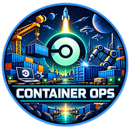

  
  <h1>Container Ops Orb</h1>
  <i>A CircleCI orb that simplifies building, signing, scanning, and publishing container images.</i>  

   

## Getting Started
The goal of this orb is to share jobs that allow users to easily perform the following operations:
- Create container images using `docker`, or distroless container images using `apko` and `melange`.
- Sign the container images using `cosign`.
- Publish the container images to a container registry such as `ghcr.io`.
- Scan the contents of container images using `syft` to produce SBOMs.
- Scan the container images for vulnerabilities using `grype`.
- Publish the signature and attach SBOMs and/or scan results as attestations.

## How the Publish Job Works
The `publish` job is **tag-oriented** and **single-platform**. Check that this fits your release process before you rely on it.

### Tag-oriented
`publish` loads the image archive saved by `build`. For each tag (`tag` plus `additional_tags`, or each line of `tags_file`) it runs `docker tag` and `docker push`. Signing, SBOM generation and attestation then refer to the image by tag, as `<registry>/<registry_namespace>/<image>:<tag>`.

- Cosign signs a digest, not a tag. The cosign orb looks up the tag's digest when the signing and attestation steps run. With `crane` on the `PATH` it asks the registry, so if another pipeline moves the tag after this job's push, the job signs that other image. Without `crane` it uses the digest Docker recorded when this job pushed the tag. The verification steps look the tag up in the registry when they run.
- With `tags_file`, only the tags listed in the file are pushed, but signing, SBOM generation and attestation still use the `tag` parameter. If `sign` or `sbom` is enabled, include the `tag` value in the tags file. Otherwise that tag is not in the registry and those steps fail.
- The job does not record the digest it pushed. A downstream job that needs the digest must look up the tag itself, for example with `crane digest`.

### Single-platform
`publish` is designed and tested for single-platform images:

- `build` runs `docker build`. When `platforms` is set, it runs `docker buildx build --load` instead. With Docker's classic image store, `--load` handles only one platform, so give `platforms` a single target such as `linux/arm64`, not a list.
- `docker save` and `docker load` move that image between jobs, and `docker push` publishes it under each tag.

Multi-platform images (an OCI image index covering several architectures) are not supported. To publish one today, build and push it in your own job, for example with `docker buildx build --platform linux/amd64,linux/arm64 --push`. Then sign, attest and generate its SBOM with the `cosign` and `syft` orbs directly.

### Possible future feature: digest-first, multi-arch publishing
This is not available in the orb today. A digest-first publish would build all platforms first, then tag once:

1. Build every platform and push them as a single image index, addressed by digest, with no tags yet.
2. Sign, attest and generate SBOMs against that digest.
3. Apply every tag to the digest in the registry in one step without pushing the image again, for example with the `tag_digest` command from `container-tagger-orb`.

Signatures would then never depend on where a tag points, and every tag would carry every platform.
