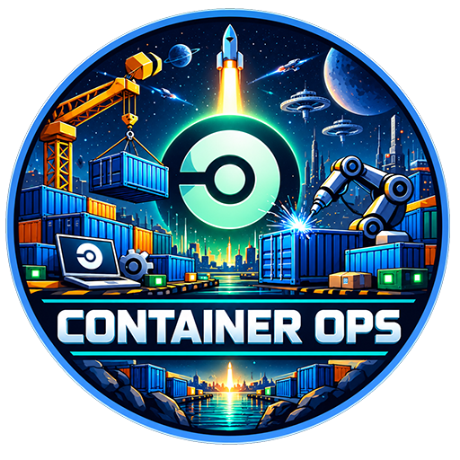
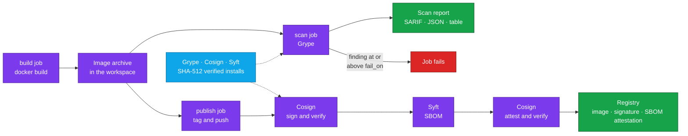

<div align="center">



# Container Ops Orb for CircleCI

### Build, scan, sign and publish container images with three CircleCI jobs.

Build an image with Docker once, gate it on a [Grype](https://github.com/anchore/grype) vulnerability scan, then push it, sign it with [Cosign](https://github.com/sigstore/cosign)<br>
and attest a [Syft](https://github.com/anchore/syft) SBOM to it, each switched on with a single parameter.<br>
Build once, publish the same image · SHA-512 verified tool installs, strict by default · Credentials passed by variable name

[](https://circleci.com/gh/juburr/container-ops-orb)
[](https://circleci.com/developer/orbs/orb/juburr/container-ops-orb)
[](LICENSE)
[](https://discuss.circleci.com/c/ecosystem/orbs)


**[Quick Start](#-quick-start)** · **[Features](#-why-container-ops-orb)** · **[Recipes](#-recipes)** · **[Jobs](#-jobs)** · **[Commands](#-commands)** · **[Security](#-secure-by-design)** · **[Network Access](#-network-access)**

<sub>A community-maintained orb. [Contributions are welcome!](#-contributing)</sub>

</div>

<br>

## ✨ Why container-ops-orb?

<table>
<tr>
<td width="33%" valign="top">
🏗️ <b>Build once, publish the same image</b><br><br>
The <code>build</code> job saves the image to the CircleCI workspace. <code>scan</code> and <code>publish</code> load that archive, so the image you scanned is the image you push, with no rebuild in between.
</td>
<td width="33%" valign="top">
🔏 <b>Signed, with an SBOM attached</b><br><br>
<code>sign: true</code>, <code>sbom: true</code> and <code>attest: true</code> sign the pushed image with Cosign, generate an SPDX or CycloneDX SBOM with Syft and attest it to the image. By default, each signature and attestation is verified with your public key right after.
</td>
<td width="33%" valign="top">
🛡️ <b>A vulnerability gate before you push</b><br><br>
The <code>scan</code> job runs Grype against the build's archive or a published image, writes SARIF by default, and with <code>fail_on: high</code> stops the workflow before <code>publish</code> runs.
</td>
</tr>
<tr>
<td width="33%" valign="top">
🏷️ <b>OCI labels, filled in for you</b><br><br>
Every build gets <code>OCI_CREATED</code>, <code>OCI_REVISION</code>, <code>OCI_VERSION</code> and <code>OCI_SOURCE</code> build arguments for your Dockerfile's labels. <code>pull_base_images</code> mixes registry base images with local-only ones from apko or melange.
</td>
<td width="33%" valign="top">
🔐 <b>Credentials by name, never by value</b><br><br>
Registry and Cosign credentials are environment variable <i>names</i>. The password reaches <code>docker login</code> on stdin, and the jobs run <code>docker logout</code> after your own steps. See <a href="#-secure-by-design">Secure by Design</a>.
</td>
<td width="33%" valign="top">
🧰 <b>Jobs or building blocks</b><br><br>
<code>before_*</code> and <code>after_*</code> steps run at documented points inside each job, and the nine <code>docker_*</code> commands the jobs are made of are yours to compose into your own jobs.
</td>
</tr>
</table>

### 🧩 The Orb vs. a Hand-Rolled Script

| | Scripting it yourself | With the orb |
| --- | --- | --- |
| Moving the image between jobs | `docker save`, persist, attach, `docker load`, and keep every path in sync | `build` saves `~/images/<image>-img.tar` to the workspace, and `scan` and `publish` load it with matching defaults. A mismatched `archive_dir` fails with an error that says where the archive must go. |
| Registry credentials | `echo` the password into `docker login`, remember to log out | `registry_username` and `registry_password` name the variables; login uses `--password-stdin`, and logout runs after your `after_*` steps |
| Signing | Install and verify Cosign, decode the key, pick the transparency-log flag for your Cosign major version, shred the key afterwards | `sign: true` (the [cosign orb](https://github.com/juburr/cosign-orb) does the rest for Cosign 1, 2 and 3) |
| SBOM attestation | Generate the SBOM, find the file, map its format to a predicate type, attest, verify | `sbom: true` and `attest: true` |
| Vulnerability gate | Install Grype, update and cache its database, name the report, choose `--fail-on` | `fail_on: high` |

## 🔄 How It Works



`build` checks out your code, builds the image with `docker build` (or `docker buildx build` for one other platform), and saves it as a tar archive in the workspace. `scan` loads that archive and scans it with Grype, failing the job when `fail_on` is set and a vulnerability reaches it. `publish` loads the same archive, tags it for your registry and pushes it, then, when you turn them on, signs it with Cosign, generates an SBOM with Syft, and attests the SBOM to the image, by default verifying each signature with your public key. The jobs install Grype, Cosign and Syft through these orbs, at the versions this orb pins:

| Step | Orb used | Tool version (default) |
| --- | --- | --- |
| `scan` | [`juburr/grype-orb@1.0.0`](https://github.com/juburr/grype-orb) | Grype `0.119.0` (`grype_version`) |
| `publish` with `sign` (and `attest`) | [`juburr/cosign-orb@1.0.0`](https://github.com/juburr/cosign-orb) | Cosign `3.1.3` (`cosign_version`) |
| `publish` with `sbom` | [`juburr/syft-orb@1.0.0`](https://github.com/juburr/syft-orb) | Syft `1.52.0` (`syft_version`) |
| `publish` with `tags_file` | [`juburr/container-tagger-orb@1.0.0`](https://github.com/juburr/container-tagger-orb) | none, uses `docker` |

## 🚀 Quick Start

Build the image in your repository's `Dockerfile`, scan it, and push it to your registry if the scan passes. Copy this into `.circleci/config.yml`:

```yaml
version: 2.1

orbs:
  container-ops-orb: juburr/container-ops-orb@1.0.0

workflows:
  build-scan-publish:
    jobs:
      - container-ops-orb/build:
          image: myapp
      - container-ops-orb/scan:
          requires:
            - container-ops-orb/build
          image: myapp
          fail_on: high
      - container-ops-orb/publish:
          requires:
            - container-ops-orb/scan
          image: myapp
          registry: ghcr.io
          registry_namespace: myorg
          additional_tags: latest
          context:
            - registry-credentials
```

Change `image`, `registry` and `registry_namespace`, and create a `registry-credentials` context with `REGISTRY_USERNAME` and `REGISTRY_PASSWORD` (or pass your own variable names to `registry_username` and `registry_password`). Every job runs on the orb's [`machine` executor](#-executors), so there's no Docker setup to add. The image is tagged with the commit SHA, which is how `scan` and `publish` find it, and pushed as `ghcr.io/myorg/myapp:<commit SHA>` and `:latest`. The scan report is printed in the `scan` job's log and persisted to the workspace under `scan-results/`. To sign the image and attach an SBOM, see [Recipes](#-recipes).

> [!TIP]
> Upgrading from an earlier version? v1.0.0 renames a command, the executor and several parameters, changes `fail_on`'s default from empty to `never`, and installs newer Cosign, Syft and Grype by default. See [Upgrading](#-upgrading).

> [!NOTE]
> `fail_on` is `never` by default, and then the `scan` job never fails on vulnerabilities, only on errors. When `fail_on` does fail the job, the steps after the scan don't run: the report isn't printed or persisted to the workspace. See [Gate on Vulnerabilities and Keep the Report](#gate-on-vulnerabilities-and-keep-the-report).

> [!IMPORTANT]
> `publish` is tag-oriented and single-platform. Read [How the Publish Job Works](#-how-the-publish-job-works) before you rely on it for releases.

## 🍳 Recipes

### Sign, Generate an SBOM and Attest It

Sign the pushed image with a Cosign key pair, generate an SPDX SBOM with Syft, and attest the SBOM to the image. The `signing-keys` context provides `COSIGN_PRIVATE_KEY` and `COSIGN_PUBLIC_KEY` (both base64-encoded) and `COSIGN_PASSWORD`, the default variable names. Generate a key pair with the [cosign orb](https://github.com/juburr/cosign-orb)'s `generate_key_pair` command or `cosign generate-key-pair`.

```yaml
version: 2.1

orbs:
  container-ops-orb: juburr/container-ops-orb@1.0.0

workflows:
  secure-publish:
    jobs:
      - container-ops-orb/build:
          image: myapp
          tags: "${CIRCLE_SHA1} latest"
      - container-ops-orb/publish:
          requires:
            - container-ops-orb/build
          image: myapp
          tag: "${CIRCLE_SHA1}"
          additional_tags: "latest"
          registry: ghcr.io
          registry_namespace: myorg
          sign: true
          sbom: true
          sbom_format: spdx-json
          attest: true
          context:
            - registry-credentials
            - signing-keys
```

Signing and attestation use the private key without the public Rekor transparency log, and `verify_signature` and `verify_attestation` (both on by default) check the results with `COSIGN_PUBLIC_KEY`. With the default Cosign 3, signatures and attestations are stored as Sigstore bundles; set `cosign_bundle_format: legacy` if something that reads them, such as `cosign verify` on Cosign 2.5 or earlier, needs the `.sig` and `.att` tags. The SBOM is written to `sboms/` in the job's working directory; add `after_publish: [store_artifacts: {path: sboms}]` to keep it as an artifact. `attest` only runs when `sign` and `sbom` are both true.

### Gate on Vulnerabilities and Keep the Report

`fail_on: high` fails the `scan` job when Grype finds a high or critical vulnerability, so `publish` never runs. The steps after a failed scan don't run, so this `after_scan` step uses `when: always` to print the report either way.

```yaml
version: 2.1

orbs:
  container-ops-orb: juburr/container-ops-orb@1.0.0

workflows:
  secure-build:
    jobs:
      - container-ops-orb/build:
          image: myapp
      - container-ops-orb/scan:
          name: security-scan
          requires:
            - container-ops-orb/build
          image: myapp
          output_format: table
          fail_on: high
          log_results: false
          after_scan:
            - run:
                name: Show the scan report, even when the gate fails
                when: always
                command: cat "${SCAN_OUTPUT_FILE}"
      - container-ops-orb/publish:
          requires:
            - security-scan
          image: myapp
          registry: ghcr.io
          registry_namespace: myorg
          context:
            - registry-credentials
```

Keep the default `output_format: sarif` instead to feed a security dashboard. When the scan passes, the report is persisted to the workspace under `scan-results/`, where a later job can attach it.

### Scan a Published Image

Scan an image that is already in a registry, for example from a scheduled pipeline that rescans production images as new vulnerabilities are published. The job logs in to `registry` with `REGISTRY_USERNAME` and `REGISTRY_PASSWORD`, and Grype scans `ghcr.io/myorg/myapp:latest` with no load or pull step.

```yaml
version: 2.1

orbs:
  container-ops-orb: juburr/container-ops-orb@1.0.0

workflows:
  scan-published:
    jobs:
      - container-ops-orb/scan:
          image: myapp
          tag: "latest"
          image_source: registry
          registry: ghcr.io
          registry_namespace: myorg
          attach_workspace: false
          fail_on: critical
          context:
            - registry-credentials
```

For a public image, leave `registry` empty and pass the full reference as `image`, such as `ghcr.io/myorg/myapp:latest`; the job then skips the login and ignores `tag`.

### Private and Local-Only Base Images

Log in to a private registry before building, and pull base images from it without Docker's `--pull` flag, which fails for base images that exist only locally (for example, built with apko or melange in a `before_build` step; this orb doesn't run apko or melange itself). A failed pull is only a warning.

```yaml
version: 2.1

orbs:
  container-ops-orb: juburr/container-ops-orb@1.0.0

workflows:
  build-workflow:
    jobs:
      - container-ops-orb/build:
          image: myorg/myapp
          tags: "latest v1.0.0 ${CIRCLE_SHA1}"
          dockerfile: containers/prod/Dockerfile
          build_context: .
          target: prod
          registry: ghcr.io
          registry_username: GH_USER
          registry_password: GH_TOKEN
          pull_base_images: "ghcr.io/myorg/base:latest ghcr.io/myorg/runtime:v1"
```

The first tag, `latest` here, is the one the archive holds, so a `publish` or `scan` job that follows this build needs `tag: latest`.

### Push the Tags From container-tagger-orb

Push release-style tags (`1.2.3`, `1.2`, `1` and `latest` for the newest `v1.2.3` git tag; `edge` and `main-<sha>` on main; `dev-<sha>` on other branches) generated by [container-tagger-orb](https://github.com/juburr/container-tagger-orb) instead of `tag` and `additional_tags`. The `publish` job doesn't check out code, so check out and generate the tags file in `before_publish`:

```yaml
version: 2.1

orbs:
  container-ops-orb: juburr/container-ops-orb@1.0.0
  tagger: juburr/container-tagger-orb@1.0.0

workflows:
  release:
    jobs:
      - container-ops-orb/build:
          image: myapp
          filters:
            tags:
              only: /^v.*/
      - container-ops-orb/publish:
          requires:
            - container-ops-orb/build
          image: myapp
          registry: ghcr.io
          registry_namespace: myorg
          tags_file: tags.txt
          before_publish:
            - checkout
            - tagger/generate_tags
          context:
            - registry-credentials
          filters:
            tags:
              only: /^v.*/
```

Only the tags in the file are pushed. Signing and SBOM generation still refer to the image by `tag` (the commit SHA by default), so if you turn them on, also append that tag to the file, for example with `- run: echo "${CIRCLE_SHA1}" >> tags.txt` after `generate_tags`. See [Tag-oriented](#tag-oriented). After the push, the job exports the most specific tag as `TAG` for `after_publish` steps.

## 📤 How the Publish Job Works

The `publish` job is **tag-oriented** and **single-platform**. Check that this fits your release process before you rely on it.

### Tag-oriented

`publish` loads the image archive saved by `build`. For each tag (`tag` plus `additional_tags`, or each line of `tags_file`) it runs `docker tag` and `docker push`. Signing, SBOM generation and attestation then refer to the image by tag, as `<registry>/<registry_namespace>/<image>:<tag>`.

- Cosign signs a digest, not a tag. The cosign orb looks up the tag's digest when the signing and attestation steps run. With `crane` on the `PATH` it asks the registry, so if another pipeline moves the tag after this job's push, the job signs that other image. Without `crane` it uses the digest Docker recorded when this job pushed the tag. The verification steps look the tag up in the registry when they run.
- With `tags_file`, only the tags listed in the file are pushed, but signing, SBOM generation and attestation still use the `tag` parameter. If `sign` or `sbom` is enabled, include the `tag` value in the tags file. Otherwise those steps fail because the tag is not in the registry. If an earlier publish left an image under that tag, they sign and inventory that older image instead.
- The job does not record the digest it pushed. A downstream job that needs the digest must look up the tag itself, for example with `crane digest`.

### Single-platform

`publish` is designed and tested for single-platform images:

- `build` runs `docker build`. When `platform` is set, it runs `docker buildx build --platform <platform> --load` instead. With Docker's classic image store, `--load` handles only one platform, so `platform` takes a single target such as `linux/arm64`, not a list.
- `docker save` and `docker load` move that image between jobs, and `docker push` publishes it under each tag.

Multi-platform images (an OCI image index covering several architectures) are not supported. To publish one today, build and push it in your own job, for example with `docker buildx build --platform linux/amd64,linux/arm64 --tag <registry>/<namespace>/<image>:<tag> --push .`. Then sign and attest it with the `cosign` orb directly. Syft scans only one platform of an image index, so generate one SBOM per platform with the `syft` orb, for example by passing each platform's manifest digest (`<registry>/<namespace>/<image>@sha256:...`) as the source.

### Possible Future Feature: Digest-First, Multi-Arch Publishing

This is not available in the orb today. A digest-first publish would build all platforms first, then tag once:

1. Build every platform and push them as a single image index, addressed by digest, with no tags yet.
2. Sign and attest that digest, and generate an SBOM for each platform's manifest.
3. Apply every tag to the digest in the registry in one step without pushing the image again, for example with the `tag_digest` command from `container-tagger-orb`.

Signatures would then never depend on where a tag points, and every tag would carry every platform.

## 🧱 Jobs

### `container-ops-orb/build`

Checks out your code and builds an image with `docker build`, or `docker buildx build` when `platform` is set, injecting OCI label build arguments. Then, by default, it prints the image's metadata with `docker_inspect`, saves `<image>:<first tag>` to `<archive_dir>/<image>-img.tar` with `docker_save`, and persists it to the workspace for `scan` and `publish`. When `registry` is set, it logs in before pulling base images and logs out at the end. Needs Docker on the executor, which the default [`machine` executor](#-executors) has.

| Parameter | Default | Description |
| --- | --- | --- |
| `image` | *required* | Image name (repository) to build, without a tag, such as `myapp` or `myorg/myapp`. Each of `tags` is applied as `<image>:<tag>`, and the archive is named after it. |
| `tags` | `${CIRCLE_SHA1}` | Tags to apply, separated by spaces, such as `latest v1.0.0 ${CIRCLE_SHA1}`. The first one is saved in the archive, so it's the `tag` that `scan` and `publish` need. |
| `dockerfile` | `Dockerfile` | Path passed to `docker build -f`. A relative path is resolved against the working directory (the checkout), as Docker does, not against `build_context`: for a Dockerfile inside another build context, include that directory, e.g. `build_context: app` with `dockerfile: app/Dockerfile`. |
| `build_context` | `.` | Build context directory, the last argument of `docker build`: an absolute path or a path relative to the working directory. |
| `target` | *(empty)* | Stage to build in a multi-stage Dockerfile, such as `prod` or `builder`. Empty builds the final stage. |
| `build_args` | *(empty)* | `KEY=VALUE` pairs separated by spaces or newlines, such as `ARG1=value1 ARG2=value2`. Each pair is passed as its own `--build-arg`, so a value can't contain whitespace; pass such a value through `extra_args`. |
| `extra_args` | *(empty)* | More arguments for `docker build` (or `docker buildx build`), added before the build context, such as `--no-cache --progress=plain`. Split like shell words, so quotes keep a value with spaces together. Environment variables such as `${CIRCLE_SHA1}` are substituted, but nothing else is expanded or run: `~` and wildcards reach Docker as written, and so do `$(...)`, backticks and `\| & ; < > ( )` inside quotes. Outside quotes, they fail the step. |
| `no_output_timeout` | `20m` | How long the build step may run without output before CircleCI stops it. Increase it for large builds. |
| `oci_labels` | `true` | Pass these build arguments for your Dockerfile's `ARG` and `LABEL` lines: `OCI_CREATED` (UTC build time, RFC 3339), `OCI_REVISION` (`CIRCLE_SHA1`), `OCI_VERSION` (see `image_version`) and `OCI_SOURCE` (`CIRCLE_REPOSITORY_URL`, when set). |
| `image_version` | *(empty)* | Value of `OCI_VERSION`, for the `org.opencontainers.image.version` label. Empty uses `CIRCLE_TAG` if set, otherwise `dev`. It doesn't tag the image, and it's ignored when `oci_labels` is false. |
| `pull_base_images` | *(empty)* | Base images to pull with [`docker_pull`](#container-ops-orbdocker_pull) before building, separated by spaces or newlines. A failed pull is only a warning. Use this instead of `pull` when some base images exist only locally (built with apko or melange, for example), and list only the registry images here. |
| `pull` | `false` | Pass `--pull` to `docker build`, so it always pulls base images from the registry. Fails if any base image exists only locally; use `pull_base_images` for mixed cases. |
| `platform` | *(empty)* | One target platform for a cross-platform build, such as `linux/arm64`, built with `docker buildx build --platform <platform> --load`. A list such as `linux/amd64,linux/arm64` isn't supported (see [Single-platform](#single-platform)). Empty builds for the runner's platform with `docker build`. |
| `buildx_builder` | *(empty)* | buildx builder instance to use. Empty uses the default builder. Only applies when `platform` is set. |
| `registry` | *(empty)* | Registry to log in to before building, for private base images, such as `ghcr.io`, `docker.io`, `gcr.io` or `123456789.dkr.ecr.us-east-1.amazonaws.com`. Empty skips login. |
| `registry_username` | `REGISTRY_USERNAME` | Name of the environment variable holding the registry username. Only used when `registry` is set. |
| `registry_password` | `REGISTRY_PASSWORD` | Name of the environment variable holding the registry password or access token. Only used when `registry` is set. |
| `archive` | `true` | Save the built image (`<image>:<first tag>`) with `docker save` to `<archive_dir>/<image>-img.tar`, with each `/` in `image` replaced by `-`. |
| `archive_dir` | `~/images` | Directory for the archive: an absolute path, a path starting with `~`, or a path relative to the working directory. When `persist_to_workspace` is true, it must be `<workspace_root>/images` (the default with the default `workspace_root`), or the job fails. |
| `persist_to_workspace` | `true` | Persist the archive to the workspace for later jobs. Only applies when `archive` is true. It persists the `images` directory under `workspace_root`, so `archive_dir` must be `<workspace_root>/images`. |
| `workspace_root` | `~` | Root directory of the persisted workspace. A downstream job that attaches the workspace at `<path>` finds the archive in `<path>/images`. |
| `inspect` | `true` | Run [`docker_inspect`](#container-ops-orbdocker_inspect) on the built image to check its labels and configuration. |
| `attach_workspace` | `false` | Attach the workspace from an earlier job before building, when base images or build artifacts are in it. |
| `attach_workspace_at` | `.` | Path to attach the workspace at. |
| `before_build` | `[]` | Steps to run after checkout and the optional workspace attach, and before registry login, base image pulls and the build. CircleCI's built-in `pre-steps`, by contrast, run before checkout. |
| `after_build` | `[]` | Steps to run after the build, inspect, archive and workspace persist steps, and before registry logout, so they can still use the login. Files they create are not in the workspace this job persists. CircleCI's built-in `post-steps`, by contrast, run after logout. |
| `executor` | `machine` | Executor to run the job on: this orb's [`machine` executor](#container-ops-orbmachine) by default. To change its image or resource class, pass them to it, e.g. `executor: {name: container-ops-orb/machine, resource_class: large}`. |

### `container-ops-orb/publish`

Attaches the workspace, logs in to `registry`, loads the archive `build` saved, and pushes the image as `<registry>/<registry_namespace>/<image>` under `tag` plus `additional_tags` (or the tags in `tags_file`). Optionally signs it with Cosign, generates an SBOM with Syft and attests the SBOM, verifying each with your public key, then logs out. It doesn't check out code. Read [How the Publish Job Works](#-how-the-publish-job-works) for what "tag-oriented" and "single-platform" mean here.

| Parameter | Default | Description |
| --- | --- | --- |
| `image` | *required* | Local image name (repository, without a tag) from the `build` job, such as `myapp`. It selects the archive `<image>-img.tar` and names the pushed repository. |
| `registry` | *required* | Registry hostname to push to, such as `ghcr.io`, `docker.io`, `gcr.io` or `123456789.dkr.ecr.us-east-1.amazonaws.com`. |
| `registry_namespace` | *required* | Namespace or organization path: `myorg` pushes to `ghcr.io/myorg/myapp`. |
| `tag` | `${CIRCLE_SHA1}` | The tag `build` saved, its first tag (by default the commit SHA). The job retags `<image>:<tag>` for the registry, and signs, inventories (SBOM) and attests `<registry>/<registry_namespace>/<image>:<tag>`. Without `tags_file`, the image is pushed as this tag plus `additional_tags`; with `tags_file`, as the tags in that file. It isn't used for loading: the archive restores the tag saved in it. |
| `additional_tags` | *(empty)* | More tags to push besides `tag`, separated by spaces, such as `latest v1.0.0`. Not used with `tags_file`. |
| `tags_file` | *(empty)* | Path to a tags file with one tag per line, such as one generated by [container-tagger-orb](https://github.com/juburr/container-tagger-orb). When set, the job tags and pushes with that orb's `tag` and `push` commands instead of `docker_tag` and `docker_push`, then exports the most specific tag as `TAG` with its `export_tag` command. |
| `registry_username` | `REGISTRY_USERNAME` | Name of the environment variable holding the registry username. |
| `registry_password` | `REGISTRY_PASSWORD` | Name of the environment variable holding the registry password or access token. |
| `attach_workspace` | `true` | Attach the workspace to get the archive. Set to false when the archive reaches `archive_dir` another way, for example from a `before_publish` step: the job always loads it from there. |
| `attach_workspace_at` | `~` | Path to attach the workspace at. |
| `archive_dir` | `~/images` | Directory that holds the archive (`<image>-img.tar`). `build` persists its `archive_dir` as `images` under its `workspace_root`, so with the workspace attached at `attach_workspace_at` the archive is in `<attach_workspace_at>/images`; the defaults of both jobs agree. |
| `verify_checksums` | `strict` | SHA-512 verification of the Cosign and Syft downloads, passed to `cosign/install` and `syft/install`: `strict` fails unless the version's checksum is in the installing orb's table and matches (recommended), `known_versions` installs versions missing from the table without verification, `false` never verifies (not recommended). With `strict`, a `cosign_version` or `syft_version` the installing orb has no checksum for fails the job. |
| `sign` | `false` | Sign the pushed image with Cosign using a private key. Needs `cosign_private_key` and `cosign_password`. |
| `cosign_version` | `3.1.3` | Cosign version to install for signing and attestation. |
| `cosign_bundle_format` | `auto` | How signatures and attestations are stored, passed to the cosign orb's `bundle_format`: `auto` uses the installed Cosign's default (Sigstore bundles, stored as OCI referrers, for Cosign 3; legacy for Cosign 1 and 2), `bundle` always stores Sigstore bundles (Cosign 2.6.0 or later), `legacy` stores `sha256-<hex>.sig` and `.att` tags next to the image, which verifiers on older Cosign versions read. Cosign 3 deprecates `legacy`. |
| `cosign_private_key` | `COSIGN_PRIVATE_KEY` | Name of the environment variable holding the base64-encoded Cosign private key. |
| `cosign_password` | `COSIGN_PASSWORD` | Name of the environment variable holding the private key's password. |
| `cosign_public_key` | `COSIGN_PUBLIC_KEY` | Name of the environment variable holding the base64-encoded Cosign public key, used by `verify_signature` and `verify_attestation`. |
| `verify_signature` | `true` | Verify the signature with `cosign_public_key` right after signing. Only applies when `sign` is true. |
| `sbom` | `false` | Generate an SBOM of the pushed image with Syft, in `sboms/` under the working directory. The syft orb runs Syft with `--enrich all`, so `syft_version` must be 1.13.0 or later. |
| `sbom_format` | `spdx-json` | `spdx-json` (SPDX JSON) or `cyclonedx-json` (CycloneDX JSON), each in the spec version Syft writes by default. |
| `syft_version` | `1.52.0` | Syft version to install for SBOM generation. |
| `log_sbom` | `false` | Print the generated SBOM in the job log. |
| `attest` | `false` | Attest the SBOM to the image with Cosign, with predicate type `spdxjson` or `cyclonedx` to match `sbom_format`. Only runs when `sign` and `sbom` are also true. |
| `verify_attestation` | `true` | Verify the attestation with `cosign_public_key` right after attesting. Only applies when the attestation runs. |
| `before_publish` | `[]` | Steps to run after the optional workspace attach, and before registry login and loading the image. CircleCI's built-in `pre-steps`, by contrast, run before the workspace attach. |
| `after_publish` | `[]` | Steps to run after the push and the optional signing, SBOM and attestation steps, and before registry logout, so they can still use the login. CircleCI's built-in `post-steps`, by contrast, run after logout. |
| `executor` | `machine` | Executor to run the job on: this orb's [`machine` executor](#container-ops-orbmachine) by default. To change its image or resource class, pass them to it, e.g. `executor: {name: container-ops-orb/machine, resource_class: large}`. |

### `container-ops-orb/scan`

Scans an image for vulnerabilities with Grype: by default the archive `build` saved, loaded into Docker; or the archive file itself; or an image in a registry. It installs Grype, updates its vulnerability database (both cached between jobs), writes the report to `output_dir`, prints it, and persists `output_dir` to the workspace. It doesn't check out code.

| Parameter | Default | Description |
| --- | --- | --- |
| `image` | *required* | Image to scan. With `image_source` `local` or `archive`, the local image name from `build`, such as `myapp`. With `registry`, the repository under `registry` and `registry_namespace`, or the full reference (such as `ghcr.io/myorg/myapp:v1.0.0`) when `registry` is empty. |
| `tag` | `${CIRCLE_SHA1}` | Tag to scan. With `image_source: local`, the job scans `<image>:<tag>` after loading the archive, so it must be the tag `build` saved (its first tag). With `image_source: registry` and `registry` set, it completes `<registry>[/<registry_namespace>]/<image>:<tag>`. Not used with `archive`, or with `registry` when `registry` is empty. |
| `image_source` | `local` | Where the image comes from: `local` loads the archive with [`docker_load`](#container-ops-orbdocker_load) and scans the loaded image, `registry` scans the image from the registry with no load or pull step, `archive` scans the tar archive directly (`docker-archive:`) without loading it. |
| `archive_dir` | `~/images` | Directory that holds the archive (`<image>-img.tar`) saved by `build`. Used when `image_source` is `local` or `archive`. With the default `attach_workspace_at` (`~`), the build job's defaults put it in `~/images`. |
| `registry` | *(empty)* | Registry hostname for registry scans, such as `ghcr.io`, `docker.io` or `gcr.io`. When set, the job also logs in to it before the scan and out after, whatever the `image_source`. |
| `registry_namespace` | *(empty)* | Namespace or organization path, used with `registry` to build `<registry>/<registry_namespace>/<image>:<tag>`. |
| `registry_username` | `REGISTRY_USERNAME` | Name of the environment variable holding the registry username. Only used when `registry` is set. |
| `registry_password` | `REGISTRY_PASSWORD` | Name of the environment variable holding the registry password. Only used when `registry` is set. |
| `grype_version` | `0.119.0` | Grype version to install. |
| `verify_checksums` | `strict` | SHA-512 verification of the Grype download, passed to `grype/install`: `strict` fails unless the version's checksum is known to the grype orb and matches (recommended), `known_versions` installs versions missing from the table without verification, `false` never verifies (not recommended). With `strict`, a `grype_version` the grype orb has no checksum for fails the job. |
| `output_format` | `sarif` | Report format: `sarif` (for security tools), `json`, `table` (human-readable), `cyclonedx` (CycloneDX XML) or `cyclonedx-json`. The report's extension is `.sarif`, `.json`, `.txt`, `.cdx.xml` or `.cdx.json`. |
| `fail_on` | `never` | Fail the job if Grype finds a vulnerability at or above this severity: `negligible`, `low`, `medium`, `high` or `critical`. `never` reports vulnerabilities without failing the job. |
| `output_dir` | `scan-results` | Directory for the report, named `<scan target>.grype.<extension>` with each `/` and `:` in the target replaced by `__`, e.g. `myapp__<sha>.grype.sarif`. |
| `log_results` | `true` | Print the report in the job log. |
| `persist_to_workspace` | `true` | Persist `output_dir` to the workspace for later jobs. |
| `workspace_root` | `.` | Root directory for that workspace persist. |
| `attach_workspace` | `true` | Attach the workspace from an earlier job. Required to scan the archive produced by `build`. |
| `attach_workspace_at` | `~` | Path to attach the workspace at. |
| `before_scan` | `[]` | Steps to run after the optional workspace attach, and before creating `output_dir`, registry login, loading the image and installing Grype. CircleCI's built-in `pre-steps`, by contrast, run before the workspace attach. |
| `after_scan` | `[]` | Steps to run after the scan and the optional display of its results, and before registry logout and the optional workspace persist, so files they add to `output_dir` are persisted. Like the steps after them, they don't run when the scan fails (for example because of `fail_on`), unless a `run` step sets `when: always`. CircleCI's built-in `post-steps`, by contrast, run after the workspace persist. |
| `executor` | `machine` | Executor to run the job on: this orb's [`machine` executor](#container-ops-orbmachine) by default. To change its image or resource class, pass them to it, e.g. `executor: {name: container-ops-orb/machine, resource_class: large}`. |

## 🧰 Commands

The jobs are built from these commands, and you can use them in your own jobs. Each needs `docker` on the executor.

### `container-ops-orb/docker_build`

Builds an image with `docker build`, or `docker buildx build --platform <platform> --load` when `platform` is set, with BuildKit on, the OCI label build arguments, and every tag in `tags`. The parameters work as in the [`build` job](#container-ops-orbbuild). Exports `BUILT_IMAGE`, `BUILT_IMAGE_TAG` (the first tag) and `BUILT_IMAGE_FULL` for later steps, which `docker_inspect` and `docker_save` read when their `tag` is empty.

| Parameter | Default | Description |
| --- | --- | --- |
| `image` | *required* | Image name (repository) to build, without a tag, such as `myapp` or `myorg/myapp`. |
| `tags` | `${CIRCLE_SHA1}` | Tags to apply as `<image>:<tag>`, separated by spaces. |
| `dockerfile` | `Dockerfile` | Path passed to `docker build -f`, resolved against the working directory, not `build_context`. |
| `build_context` | `.` | Build context directory, absolute or relative to the working directory. |
| `target` | *(empty)* | Stage to build in a multi-stage Dockerfile. Empty builds the final stage. |
| `build_args` | *(empty)* | `KEY=VALUE` pairs separated by spaces or newlines, each passed as its own `--build-arg`. |
| `extra_args` | *(empty)* | More `docker build` arguments, split like shell words. Environment variables are substituted; nothing else is expanded or run. |
| `oci_labels` | `true` | Pass the `OCI_CREATED`, `OCI_REVISION`, `OCI_VERSION` and `OCI_SOURCE` build arguments. |
| `image_version` | *(empty)* | Value of `OCI_VERSION`. Empty uses `CIRCLE_TAG` if set, otherwise `dev`. |
| `pull` | `false` | Pass `--pull` to `docker build`. Fails if any base image exists only locally; use `docker_pull` for mixed cases. |
| `platform` | *(empty)* | One target platform for a buildx build, such as `linux/arm64`. Empty builds for the runner's platform. |
| `buildx_builder` | *(empty)* | buildx builder instance to use. Empty uses the default builder. Only applies when `platform` is set. |
| `no_output_timeout` | `20m` | How long the build step may run without output before CircleCI stops it. |

### `container-ops-orb/docker_inspect`

Prints an image's ID, creation time, size, architecture and OS, then its labels, environment variables, exposed ports, entrypoint and command, and the first 100 lines of `docker image inspect`. Fails if the image doesn't exist.

| Parameter | Default | Description |
| --- | --- | --- |
| `image` | *required* | Image name to inspect, such as `myapp` or `myorg/myapp`. |
| `tag` | *(empty)* | Tag to inspect. Empty uses `BUILT_IMAGE_TAG` from `docker_build`, or `latest` if that isn't set. |

### `container-ops-orb/docker_load`

Loads an image from the archive `docker_save` wrote, `<archive_dir>/<image>-img.tar`, with whatever tags it holds. Fails, listing the directory's contents, when the archive isn't there. Exports `LOADED_IMAGE`.

| Parameter | Default | Description |
| --- | --- | --- |
| `image` | *required* | Image name (repository) that was saved, without a tag, such as `myapp` or `myorg/myapp`. It selects the archive `<image>-img.tar`, with each `/` replaced by `-`. |
| `archive_dir` | `~/images` | Directory that holds the archive: absolute, starting with `~`, or relative to the working directory. The default matches `docker_save`'s default with the workspace attached at `~`. |

### `container-ops-orb/docker_login`

Logs in to a registry with `docker login`, reading the username and password from the environment variables you name and passing the password on stdin. Fails if either variable is unset or empty.

| Parameter | Default | Description |
| --- | --- | --- |
| `registry` | *required* | Registry to log in to, such as `ghcr.io`, `docker.io`, `gcr.io` or `123456789.dkr.ecr.us-east-1.amazonaws.com`. |
| `username` | `REGISTRY_USERNAME` | Name of the environment variable holding the username (the variable's name, not the username itself). |
| `password` | `REGISTRY_PASSWORD` | Name of the environment variable holding the password or access token (the variable's name, not the secret itself). |

### `container-ops-orb/docker_logout`

Logs out of a registry with `docker logout`, removing the stored credentials.

| Parameter | Default | Description |
| --- | --- | --- |
| `registry` | *required* | Registry to log out of, such as `ghcr.io`, `docker.io` or `gcr.io`. |

### `container-ops-orb/docker_pull`

Pulls images before a build. A failed pull is printed as a warning and doesn't fail the step, since an image may exist only locally (built with apko or melange, for example); a later `docker build` without `--pull` uses a local copy if one exists, and otherwise tries to pull it again.

| Parameter | Default | Description |
| --- | --- | --- |
| `images` | *required* | Image references to pull, separated by spaces or newlines, such as `ghcr.io/myorg/base:latest gcr.io/project/runtime:v1`. |

### `container-ops-orb/docker_push`

Pushes `<image>:<tag>` for each tag. Run `docker_login` first. Exports `PUSHED_IMAGE`, `PUSHED_IMAGE_TAG` (the first tag pushed) and `PUSHED_IMAGE_FULL`.

| Parameter | Default | Description |
| --- | --- | --- |
| `image` | *required* | Image reference without a tag, including the registry and namespace, such as `ghcr.io/myorg/myapp`. |
| `tags` | *required* | Tags to push, separated by spaces, such as `latest v1.0.0 ${CIRCLE_SHA1}`. |

### `container-ops-orb/docker_save`

Saves an image with `docker save` to `<archive_dir>/<image>-img.tar`, creating `archive_dir` if needed, and by default persists the `images` directory under `workspace_root` to the workspace. Fails when `persist_to_workspace` is true and `archive_dir` isn't `<workspace_root>/images`. Exports `ARCHIVED_IMAGE_PATH` and `ARCHIVED_IMAGE_NAME`.

| Parameter | Default | Description |
| --- | --- | --- |
| `image` | *required* | Image name (repository) to save, without a tag. The archive is named `<image>-img.tar`, with each `/` replaced by `-`. |
| `tag` | *(empty)* | Tag to save. Empty uses `BUILT_IMAGE_TAG` from `docker_build`, or `latest` if that isn't set. |
| `archive_dir` | `~/images` | Directory to save the archive in: absolute, starting with `~`, or relative to the working directory. When `persist_to_workspace` is true, it must be `<workspace_root>/images` (the default with the default `workspace_root`). |
| `persist_to_workspace` | `true` | Persist the `images` directory under `workspace_root` to the workspace. To save elsewhere, set this to false and add your own `persist_to_workspace` step. |
| `workspace_root` | `~` | Root directory of the persisted workspace. A downstream job that attaches the workspace at `<path>` finds the archive in `<path>/images`. |

### `container-ops-orb/docker_tag`

Applies each tag to a local image as `<target_image>:<tag>`, ready for `docker_push`. Fails, listing the local images, when `source_image` doesn't exist. Exports `TAGGED_IMAGE`, `TAGGED_IMAGE_TAG` (the first tag) and `TAGGED_IMAGE_FULL`.

| Parameter | Default | Description |
| --- | --- | --- |
| `source_image` | *required* | Source image reference including its tag, such as `myapp:abc123`. |
| `target_image` | *required* | Target image reference without a tag, including the registry and namespace, such as `ghcr.io/myorg/myapp`. |
| `tags` | *required* | Tags to apply, separated by spaces, such as `latest v1.0.0 ${CIRCLE_SHA1}`. |

Environment variables (such as `${CIRCLE_SHA1}`) are expanded in every string parameter of these commands except `docker_build`'s `no_output_timeout` and `docker_save`'s `workspace_root`, and the jobs pass their image, tag, path and registry parameters through to these commands or to the composed orbs' commands, which expand them too. `docker_login`'s `username` and `password` are variable names and aren't expanded. The jobs' `attach_workspace_at` and `workspace_root`, which only feed CircleCI's workspace steps, are used as written. `tags` in `docker_build`, `docker_push` and `docker_tag` is read from its first line.

## 🏃 Executors

### `container-ops-orb/machine`

A Linux VM with Docker pre-installed, and the default executor of the `build`, `publish` and `scan` jobs. Docker runs natively on the VM, so the jobs need no `setup_remote_docker`.

| Parameter | Default | Description |
| --- | --- | --- |
| `image` | `ubuntu-2404:current` | CircleCI machine image (Ubuntu 24.04 with a current Docker Engine by default). The jobs need a local Docker daemon, which CircleCI's Linux machine images include. |
| `resource_class` | `medium` | CircleCI resource class, such as `large` or `arm.medium`. |

To change the image or resource class, pass them to the executor:

```yaml
- container-ops-orb/build:
    executor:
      name: container-ops-orb/machine
      resource_class: large
```

You can pass any other executor that has Docker available. The jobs don't run `setup_remote_docker` themselves, which is why a machine executor is the default.

## 📦 Upgrading

v1.0.0 renames a command, the executor and several parameters. Update your config as follows:

| Where | Old | New |
|---|---|---|
| command | `docker_archive` | `docker_save` |
| executor | `default` | `machine` |
| `docker_save` | `output_path` | `archive_dir` |
| `docker_load` | `archive_path` | `archive_dir` |
| `build`, `publish`, `scan` jobs | `archive_path` | `archive_dir` |
| `docker_build` | `context` | `build_context` |
| `build` job | `docker_context` | `build_context` |
| `docker_build`, `build` job | `extra_docker_args` | `extra_args` |
| `docker_build`, `build` job | `version` | `image_version` |
| `docker_build`, `build` job | `use_pull_flag` | `pull` |
| `docker_build`, `build` job | `platforms` | `platform` |
| `scan` job | `scan_source` | `image_source` |
| `build` job | `pre_steps` / `post_steps` | `before_build` / `after_build` |
| `publish` job | `pre_steps` / `post_steps` | `before_publish` / `after_publish` |
| `scan` job | `pre_steps` / `post_steps` | `before_scan` / `after_scan` |
| `docker_login` `username` / `password`, jobs' `registry_username` / `registry_password` | default `DOCKER_USERNAME` / `DOCKER_PASSWORD` | default `REGISTRY_USERNAME` / `REGISTRY_PASSWORD` |
| `scan` job | `fail_on: ""`, the default | `fail_on: never`, the default |

The `before_*` and `after_*` steps run at the same points as the old `pre_steps` and `post_steps`; each job's parameter descriptions say exactly where. If your context defines `DOCKER_USERNAME` and `DOCKER_PASSWORD`, rename those variables or pass their names to `username` / `password` or `registry_username` / `registry_password`.

Behavior changes:
- The jobs use cosign-orb, syft-orb, grype-orb and container-tagger-orb 1.0.0, and install newer tools by default: Cosign 3.1.3 instead of 2.4.0, Syft 1.52.0 instead of 1.11.0, and Grype 0.119.0 instead of 0.87.0. Pin `cosign_version`, `syft_version` or `grype_version` to keep an older release.
  - Cosign 3 stores signatures and attestations as Sigstore bundles, OCI referrers of the image, instead of the `sha256-<hex>.sig` and `.att` tags. Set the new `cosign_bundle_format: legacy` to keep those tags, for example while a verifier still runs Cosign 2.5 or earlier.
  - `sbom: true` works with the default `syft_version`. Before, the syft orb ran Syft 1.11.0 with `--enrich all`, a flag added in Syft 1.13.0, so it failed unless you set a newer version.
  - Grype 0.88.0 and later download the vulnerability database from `grype.anchore.io` instead of `toolbox-data.anchore.io`. See [Network Access](#-network-access).
- Grype, Cosign and Syft are installed into `$HOME/bin`, the 1.0.0 orbs' default, instead of `/home/circleci/bin`. On CircleCI's images, that's the same directory.
- `build_args` and `docker_pull`'s `images` (the `build` job's `pull_base_images`) are split on any whitespace, spaces or newlines. Before, a space-separated list such as `A=1 B=2` reached Docker as a single value.
- `docker_save` (and the `build` job) fail when `persist_to_workspace` is true and `archive_dir` is not `<workspace_root>/images`. The workspace step can persist only that directory. Before, it persisted `<workspace_root>/images` anyway, so the archive was missing from the workspace, or the step failed when that directory did not exist.
- A relative `dockerfile` is checked relative to the working directory, where `docker build -f` looks for it, not relative to the build context. Before, the check also accepted `<build context>/<dockerfile>`, but Docker still read the path relative to the working directory, so the build failed or used a different Dockerfile.
- `extra_args` is no longer run through the shell's `eval`. It is still split like shell words, with quotes, backslashes and `#` comments, and environment variables are still substituted, but nothing else is expanded or run, so a variable's value can no longer run a command. `~` and wildcards reach Docker as written, and so do `$(...)`, backticks and the shell operators `| & ; < > ( )` inside quotes. Outside quotes, a `$(...)`, backtick or operator (a redirection, a pipe, a `<(...)`) fails the step before the build, since it would not run; so do an unmatched quote, a backslash at the very end, and bash's `$'...'` or `$"..."` quoting.
- Error and warning messages start with `ERROR:` or `WARN:` and go to stderr. Before, they went to stdout, a missing `docker` printed `FATAL:`, and a failed pull in `docker_pull` printed `WARNING:`.

## 🔒 Secure by Design

- **Least Privilege**: No `sudo` anywhere in this orb. The jobs install Grype, Cosign and Syft into `$HOME/bin`, the composed orbs' user-owned default.
- **Integrity**: The `publish` and `scan` jobs default to `verify_checksums: strict`, so every Cosign, Syft and Grype binary is checked against the SHA-512 table of the orb that installs it, and a version missing from that table fails the job instead of running unverified. And because `scan` and `publish` load the archive `build` saved, the image you push is the image you scanned.
- **Provenance**: Cosign, Syft and Grype come from their official GitHub releases ([sigstore/cosign](https://github.com/sigstore/cosign/releases), [anchore/syft](https://github.com/anchore/syft/releases), [anchore/grype](https://github.com/anchore/grype/releases)), through the juburr orbs this orb pins by version.
- **Confidentiality**: Registry and Cosign credentials are passed as environment variable *names* (`env_var_name` parameters), never as values in your config. `docker_login` reads the password from the named variable, turns shell tracing off, and hands the password to `docker login --password-stdin` rather than putting it on the command line, and the jobs run `docker logout` after your `after_*` steps. The cosign orb writes the decoded private key to a `0400` file and shreds it when the signing or attestation step exits. `extra_args` is split without `eval`, and this orb's scripts quote the values they export to later steps with `printf %q`, so an environment variable's value can't run a command.
- **No public transparency log**: Private-key signing and attestation skip Sigstore's public Rekor log, and verification doesn't look for entries in it, so nothing about your images is published outside your registry.
- **Privacy**: No usage data of any kind is collected or shipped back to the orb developer. Grype and Syft check `toolbox-data.anchore.io` for a newer version when they start; set `GRYPE_CHECK_FOR_APP_UPDATE` and `SYFT_CHECK_FOR_APP_UPDATE` to `false`, for example in a context, to turn that off.

> [!IMPORTANT]
> **Info for security teams:** see [Network Access](#-network-access) for the hosts to allow on locked-down or self-hosted runners.

## 💻 Supported Platforms

Linux executors with a Docker daemon. The jobs default to this orb's [`machine` executor](#-executors) (`ubuntu-2404:current` on the `medium` resource class) because they don't run `setup_remote_docker`; any executor with Docker works. Steps run in bash.

| | amd64 (`x86_64`) | arm64 (`aarch64`) |
| --- | :---: | :---: |
| `build` job and the `docker_*` commands | ✅ | ✅ |
| `publish` job: tag and push | ✅ | ✅ |
| `publish` job: `sign`, `sbom`, `attest` | ✅ | ✅ |
| `scan` job | ✅ | ✅ |

The `build` job and the `docker_*` commands only run `docker`, so they work wherever Docker does. The `scan` job and the `publish` job's signing, SBOM and attestation steps install Grype, Cosign and Syft through grype-orb, cosign-orb and syft-orb 1.0.0, which pick the Linux amd64 or arm64 build from the executor's CPU and test both. This orb's CI runs its jobs on amd64. To build an arm64 image on amd64, set `platform: linux/arm64` on `build`.

Cosign, Syft and Grype are cached between jobs per tool version, and Grype's vulnerability database is cached too. The Cosign steps also need `jq` on the executor.

## 🌐 Network Access

Hosts to allow (HTTPS, port 443) when running on a locked-down or self-hosted runner:

| Host | Needed by | Purpose |
| --- | --- | --- |
| Your `registry`, plus the authentication and storage hosts it redirects clients to | `publish`; `build` and `scan` when `registry` is set; `scan` with `image_source: registry` | Login, image push and pull, and storing and verifying signatures and attestations |
| The registries of your base images, e.g. Docker Hub's `registry-1.docker.io`, `auth.docker.io`, `production.cloudfront.docker.com` and `production.cloudflare.docker.com` | `build` | Base image pulls by `docker build` and `pull_base_images` |
| `github.com` | `scan`; `publish` with `sign` or `sbom` | Grype, Cosign and Syft downloads from their official releases |
| `release-assets.githubusercontent.com` | `scan`; `publish` with `sign` or `sbom` | Where GitHub redirects release downloads |
| `objects.githubusercontent.com` | `scan`; `publish` with `sign` or `sbom` | GitHub's previous redirect target for release downloads; allow it as well so a change on GitHub's side doesn't break downloads |
| `grype.anchore.io` | `scan` with the default `grype_version`, or any 0.88.0 or later | Grype's vulnerability database |
| `toolbox-data.anchore.io` | `scan` with `grype_version` 0.87.0 or earlier | Grype's vulnerability database on older Grype versions |

Optional hosts. The jobs carry on without them:

| Host | Used for | Notes |
| --- | --- | --- |
| `toolbox-data.anchore.io` | Grype's and Syft's update check at startup | Set `GRYPE_CHECK_FOR_APP_UPDATE` and `SYFT_CHECK_FOR_APP_UPDATE` to `false` to skip it. |
| Package registries such as Maven Central, npm and the Go module proxy | `sbom` | The syft orb runs Syft with `--enrich all`, which looks up package metadata such as licenses online. See the [syft orb](https://github.com/juburr/syft-orb) for the hosts. |

Signing and verifying with a private key, as `publish` does, needs no Sigstore hosts with the default Cosign 3.1.3, since the transparency log is off. The [cosign orb](https://github.com/juburr/cosign-orb) documents the exceptions for other Cosign versions and formats.

## 🤝 Contributing

This is a community-maintained orb, and contributions are welcome! Bug reports, feature ideas and pull requests all help.

- **Found a bug or have an idea?** [Open an issue](https://github.com/juburr/container-ops-orb/issues).
- **Need a newer Cosign, Syft or Grype?** Set `cosign_version`, `syft_version` or `grype_version`. With the default `verify_checksums: strict`, the version must be in the checksum table of the orb that installs it, so add missing checksums with a pull request to the [cosign](https://github.com/juburr/cosign-orb), [syft](https://github.com/juburr/syft-orb) or [grype](https://github.com/juburr/grype-orb) orb.
- **Before opening a pull request**, run the checks CI runs. The tests use stand-ins for `docker` and `circleci`, so they need no Docker daemon.

  ```bash
  yamllint .
  shellcheck src/scripts/*/*.sh tests/*.sh
  for t in tests/*_test.sh; do bash "$t" || break; done
  circleci orb pack src > orb.yml && circleci orb validate orb.yml
  ```

## 🎨 Logo

Need the logo for a slide deck, blog post, or internal developer portal? PNGs with transparent backgrounds are in [`assets/logos`](assets/logos): [64](assets/logos/container-ops-orb-64px.png) · [128](assets/logos/container-ops-orb-128px.png) · [256](assets/logos/container-ops-orb-256px.png) · [512](assets/logos/container-ops-orb-512px.png) · [1024](assets/logos/container-ops-orb-1024px.png) px

## 📜 License

[MIT](LICENSE) © 2026 Justin Burr

<br>

<div align="center">
  
  <br>
  <sub>Build it once, scan it, sign it, ship it. If this orb helps your team, a ⭐ helps others find it.</sub>
  <br>
  <sub><a href="#container-ops-orb-for-circleci">Back to top ↑</a></sub>
</div>
